<p align="center">
  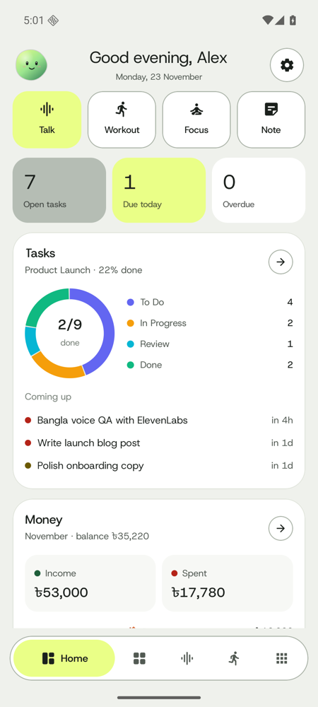
</p>

<h1 align="center">Voxban</h1>

<p align="center">
  <b>Your tasks, notes, money, workouts and passwords — run by a voice assistant that speaks your language.</b><br/>
  Native Android app · Kotlin + Jetpack Compose · Gemini / ChatGPT / Claude · ElevenLabs voices
</p>

<p align="center">
  <a href="https://github.com/meyadstack/Voxban/releases/latest"><b>⬇ Download the APK</b></a> ·
  <a href="#-setup-guide">Setup guide</a> ·
  <a href="#-build-from-source">Build from source</a>
</p>

---

Voxban is a Kanban board with a calendar, AI note taker, money manager, workout tracker, focus timer and password vault in one app, with a dashboard that sums it all up — and you can run all of it by talking. Say *“Add call the plumber tomorrow at 10”*, *“I spent 350 on lunch”*, *“Make a note: milk, eggs, dentist Thursday 4pm”* or *“Save my Netflix login with a strong password”*, and the assistant does it — in English, বাংলা, हिन्दी, Español, العربية and 7 more languages, replying in a natural ElevenLabs voice that is native to the language you chose.

## 📸 Screenshots

| Home | Dashboard charts | Workout (live) | Focus mode |
|:---:|:---:|:---:|:---:|
|  | 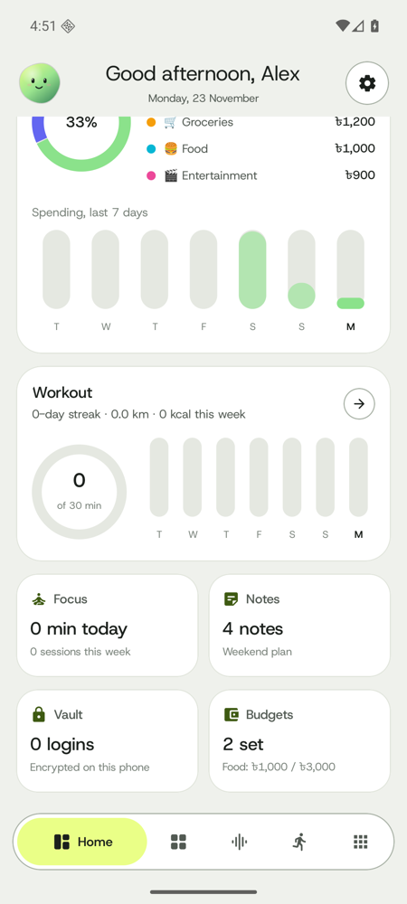 | 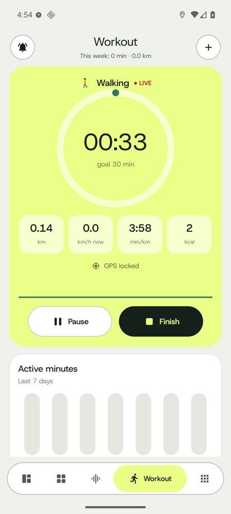 | 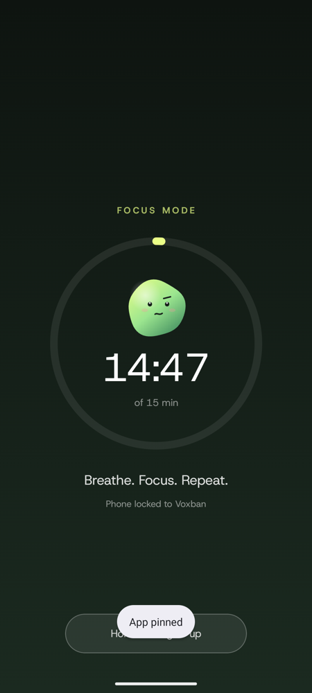 |

| Tasks | Voice AI | Listening | Chat |
|:---:|:---:|:---:|:---:|
| 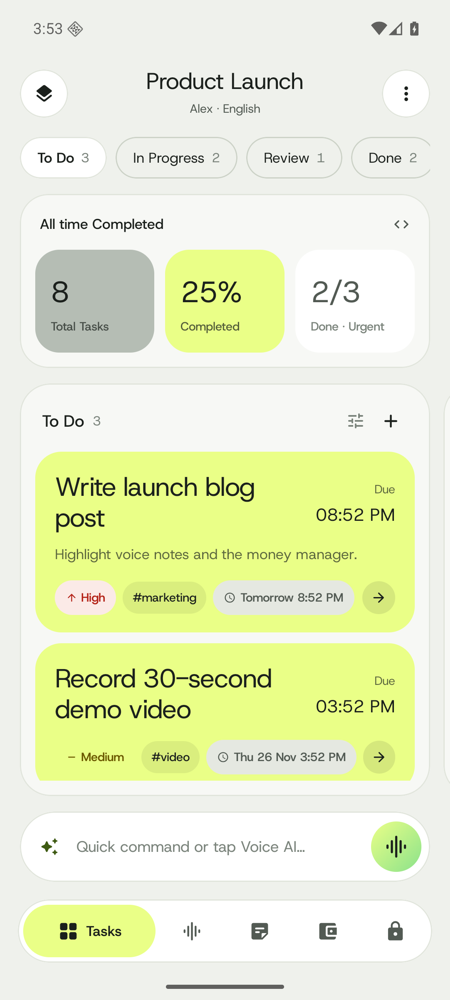 | 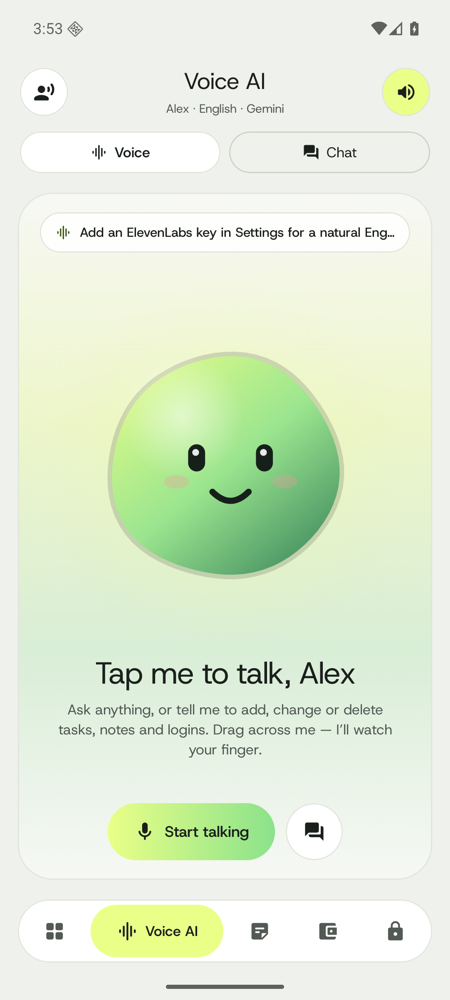 | 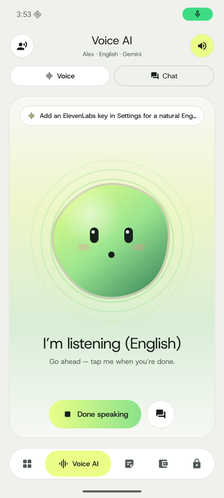 | 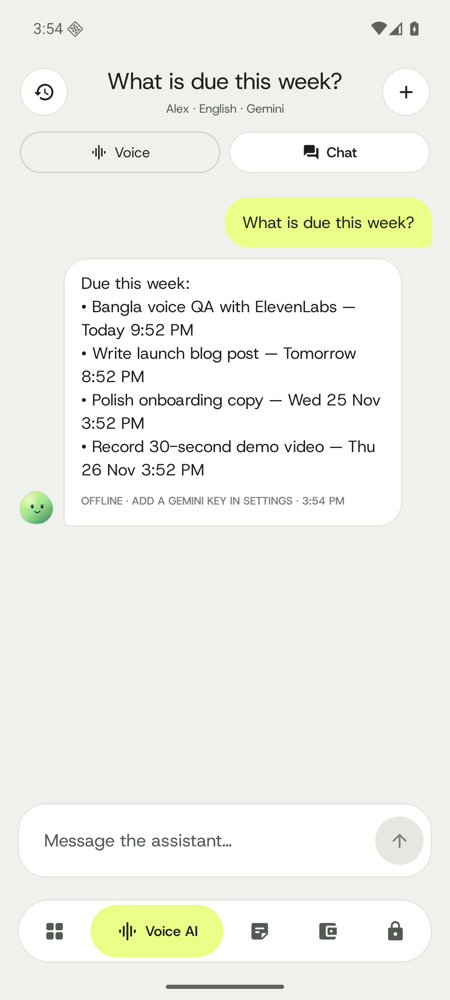 |

| AI notes | Note page | Money | Vault |
|:---:|:---:|:---:|:---:|
| 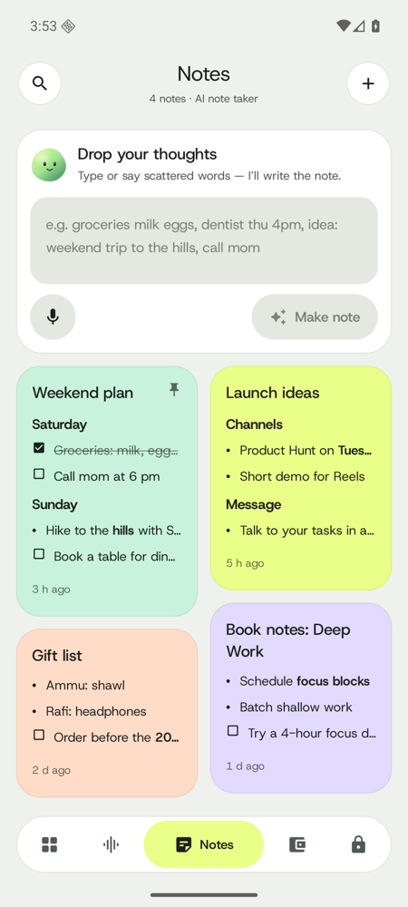 | 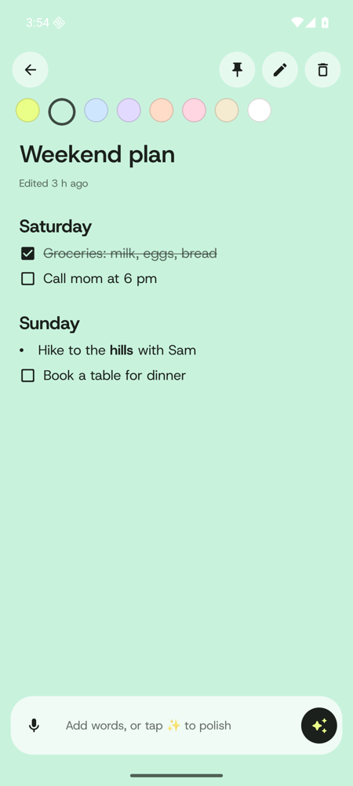 | 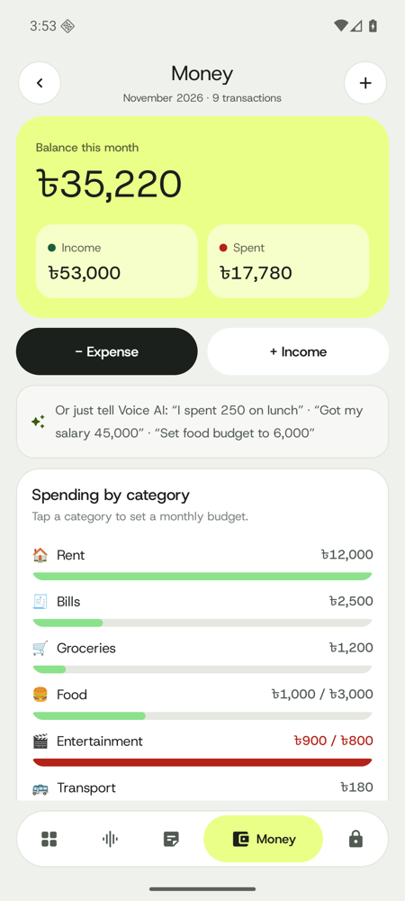 | 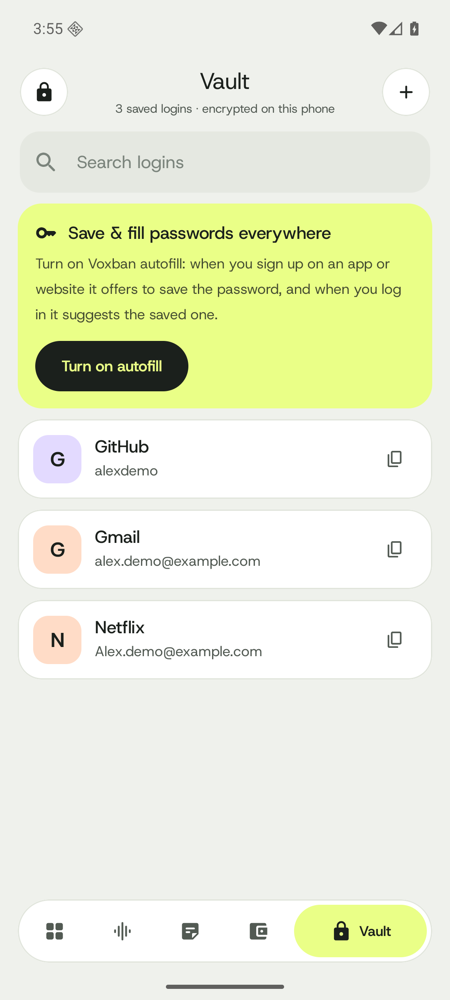 |

| Calendar | Welcome | 12 languages |
|:---:|:---:|:---:|
| 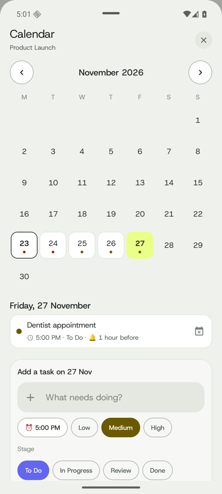 | 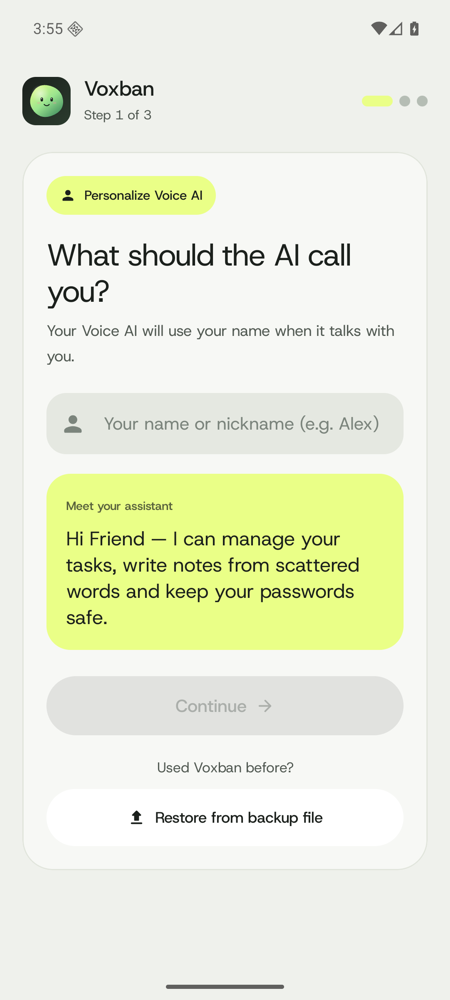 | 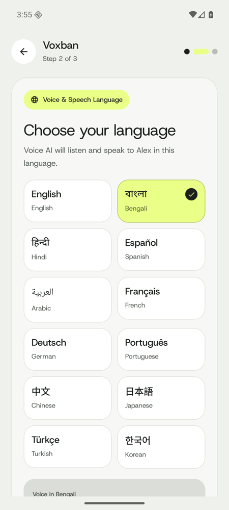 |

## ✨ Features

**🏠 Home dashboard** — everything at a glance: open / due-today / overdue tasks, a donut of tasks per stage, what’s coming up, this month’s income vs spending with a category donut and 7-day spending bars, today’s workout ring and weekly active minutes, focus time, notes, budgets and vault — each card opens its section.

**🗂 Kanban tasks + calendar** — multiple boards and stages, priorities, tags, notes and deadlines with reminders (mark done / snooze from the notification), undo for every change, and a home-screen widget. The **Calendar** button shows the month with tasks on each day; tap a day to add a task with a time, stage, priority and reminder, or move an unscheduled task onto it.

**🏃 Workouts** — walking, running, cycling, yoga, strength, HIIT — or **create your own** (name, icon, intensity, daily goal, GPS and step tracking). Start the timer and see **live** time, distance, speed, pace, steps and calories, keep going with the screen off (live notification), pause / resume, and review your history and weekly chart. A **daily workout reminder** (time + days) nudges you unless you already hit today’s goal.

**🧘 Focus mode** — pick 5–180 minutes and Voxban **locks the phone to the app** (Android app pinning) with a calm countdown screen, optionally turning on **Do Not Disturb**. It ends by itself; leaving early takes a deliberate 3-second hold.

**🎙 Voice AI with an interactive avatar** — a friendly character that blinks, follows your finger, giggles when tapped, shows ripples while it listens and moves its mouth with the real voice while it speaks. The same avatar appears in chat and is the app icon.

**🧠 The AI can create, read, update and delete everything** — tasks, boards and stages, notes, money transactions and budgets, and saved logins. Every change it makes is listed under its reply with an **Undo** button. It remembers the conversation, so follow-ups like *“move it to done”* or *“make that high priority”* work.

**💬 Chat sessions** — typed chats are saved as separate conversations you can switch between, start fresh or delete. Voice keeps its own running conversation.

**📝 AI note taker** — type or say scattered words; the AI writes a tidy note with headings, bullet points and checklists. Eight page colours, pinning, tick-off to-dos, and “add more” by typing or speaking.

**💰 Money manager** — income and expenses by category, monthly balance, budgets that turn red when you overspend, and a currency of your choice (৳, $, €, £, ₹ …). Or just say *“Got my salary 45,000”*.

**🔐 Password vault + autofill** — logins are encrypted with the phone’s keystore and unlocked with fingerprint, face or screen lock. As Android’s autofill service, Voxban offers to **save the password when you create an account** anywhere, and **suggests your saved login when you sign in** to an app or website. The AI can manage logins but never sees or speaks your passwords.

**🌍 Native voices per language** — pick an ElevenLabs voice for each language. For Bangla and other languages Voxban lists native speakers from the ElevenLabs Voice Library (marked **Free** or **Paid plan**, with a ▶ sample) and uses the model each voice is verified for.

**💾 Backup & restore** — export everything to one JSON file; after reinstalling, choose *Restore from backup file* on the first screen. Saved passwords are only included when you set a backup password, and are then encrypted with it (AES-256-GCM, PBKDF2).

**🔒 Private by design** — no account, no server. Data stays on your phone; API keys are stored encrypted and are only sent to the provider you chose.

## 🚀 Setup guide

### 1. Install
1. Download **`Voxban-x.y.z.apk`** from the [latest release](https://github.com/meyadstack/Voxban/releases/latest) on your Android phone (Android 9 or newer).
2. Open it and allow *Install unknown apps* for your browser or file manager when Android asks.
3. Open **Voxban**, enter your name, choose your language and AI model.

> Used Voxban before? On the first screen tap **Restore from backup file** and pick your exported `.json`.

### 2. Connect an AI model (choose one)
Paste the key on the onboarding screen or later in **Tasks → ⋮ → Settings → AI engine**, then tap **Test connection**.

| Model | Where to get a key | Notes |
|---|---|---|
| **Gemini** (recommended) | [aistudio.google.com](https://aistudio.google.com) → *Get API key* (starts with `AIza`) | Has a free tier |
| **ChatGPT** | [platform.openai.com](https://platform.openai.com) → *API keys* (starts with `sk-`) | Paid usage |
| **Claude** | [console.anthropic.com](https://console.anthropic.com) → *API keys* | Paid usage |

Without a key Voxban still understands simple task commands offline, but chat, notes writing, money and vault commands need a model.

### 3. Natural voices with ElevenLabs (optional, recommended)
1. Create a free account at [elevenlabs.io](https://elevenlabs.io) → *Profile* → *API keys* → create a key.
2. In **Settings → Voice**, paste it and tap **Save key**.
3. Pick your language in **Settings → Profile & language**. The voice list then shows native speakers for that language — tap ▶ to hear a sample, tap a voice to use it.
4. On the free ElevenLabs plan choose voices marked **FREE**; voices marked **PAID PLAN** need a paid subscription. If a voice can’t be used, Voxban tells you why instead of switching to another voice.

### 4. Turn on password autofill
1. Open the **Vault** tab and tap **Turn on autofill** → choose **Voxban**.
2. In **Chrome** also enable *Settings → Autofill services → Autofill using another service*.
3. Now, when you sign up on an app or website, Android asks *“Save to Voxban?”*; on sign-in screens, tap the **Voxban** suggestion and confirm with your fingerprint.

### 5. Workouts
1. Open **Workout**, tap a workout (or **+** to create your own), and allow **location** (distance & speed) and **physical activity** (steps) when asked.
2. Tap ▶ to start; use **Pause** / **Finish**. It keeps tracking with the screen off — the notification shows the live timer.
3. Tap the 🔔 button to set a **daily reminder** (time, days and workout). Set your body weight in **Settings → Workout** for accurate calories.

### 6. Focus mode
1. **More → Focus**, choose a length, keep **Lock the phone to Voxban** on, and optionally enable **Do Not Disturb** (Android asks once for permission).
2. Tap **Start focusing** and confirm **App pinned**. Home, recents and other apps are blocked until the timer ends; hold **Give up** for 3 seconds to stop early.

### 7. Back up your data
**Settings → Backup & restore → Export data (.json)**. Add a backup password to include your saved logins (you’ll need it to restore them — it can’t be recovered). Keep the file somewhere safe, e.g. Google Drive.

### Things to say
- “What should I work on next?” · “What’s overdue?”
- “Add write launch post due Friday 5pm with high priority” · “Move it to review”
- “Make a note: groceries milk eggs, call mom Sunday, trip idea hills”
- “I spent 1,200 on groceries” · “Set food budget to 3,000” · “How much did I spend this month?”
- “Save my GitHub login, username alex, generate a password” · “Show my Netflix password”

> Workout and focus are started from their screens (they need a tap to grant location / pinning).

## 🛠 Build from source

Requirements: **JDK 17+** (21 recommended), **Android SDK** with platform 37, and Android Studio or the command line.

```bash
git clone https://github.com/meyadstack/Voxban.git
cd Voxban
export ANDROID_HOME=$HOME/Library/Android/sdk     # or your SDK path
./gradlew assembleRelease                          # → app/build/outputs/apk/release/app-release.apk
```

Release signing reads `keystore/keystore.properties` (not committed):

```properties
storeFile=voxban.jks
storePassword=…
keyAlias=voxban
keyPassword=…
```

Without it the release build is signed with the debug key so it still installs. No API keys are built into the app.

### Project layout
```
app/src/main/java/com/voicekanban/app/
  ai/         assistant prompt, action parser, dispatcher, Gemini / OpenAI / Claude clients
  autofill/   Android autofill service (save + suggest logins) and unlock screen
  fitness/    live workout tracker (GPS, steps, timer), foreground service, daily reminder
  focus/      focus sessions: app pinning, Do Not Disturb, end alarm
  data/       models, repository (JSON state + encrypted vault), backup format
  reminders/  deadline alarms and notification actions
  security/   biometric lock
  ui/         Compose screens: home dashboard, tasks & calendar, voice AI & chat, workout, notes, money, vault, focus, settings
  voice/      speech recognition and ElevenLabs / phone text-to-speech
  widget/     home-screen widget
```

## 🔐 Privacy & security
- Everything is stored locally. The vault uses `EncryptedSharedPreferences` (Android Keystore, AES-256).
- Prompts sent to your AI provider include task, note and money summaries and **login names only** — never passwords.
- Passwords you type in chat are masked in the history after they are saved.
- Copied passwords are hidden from clipboard previews and cleared after 45 seconds.

---

<p align="center">Made with ♥ by <a href="https://github.com/meyadstack">meyadstack</a></p>
